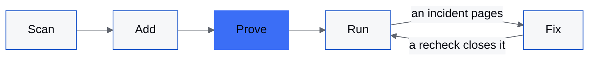
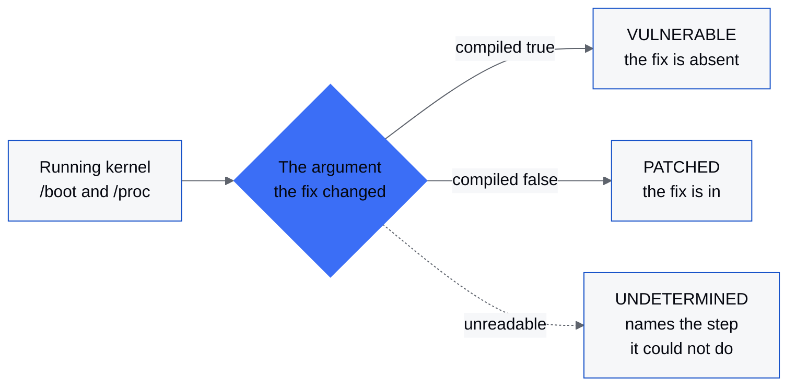

  <a href="https://ezolabs.io">
    <picture>
      <source media="(prefers-color-scheme: dark)" srcset="https://raw.githubusercontent.com/ezolabs/.github/main/profile/assets/lockup-on-dark.svg">
      
    </picture>
  </a>

<h3 align="center">We build the worlds agents work in, then the swarms that run them.</h3>

  <a href="https://ezolabs.io">ezolabs.io</a> //
  <a href="https://ezolabs.io/research">research</a> //
  <a href="https://ezolabs.io/security">security</a> //
  <a href="https://superbot.gg">superbot</a>

EZO Labs builds custom AI for companies: AI apps, fine-tuned models, forward deployed engineers and AI security. An agent is only as good as the world it works in, so we build the world first and then train the agents for it, on models we fine-tune and clusters we build. This is where the code we open up lives.

## How EZO Watcher works

EZO Watcher takes a project from one prompt to watched. Your coding agent finds what in the project can actually break, adds a check for each, and proves every check goes red before it calls the job done. It is in private preview and opens here soon.

| Stage | What happens |
| --- | --- |
| **Scan** | The agent reads the code for what can fail: readiness routes, scheduled jobs, open ports, domains, and any monitoring the project already has. |
| **Add** | Each one becomes a check with an assertion, saved as config in the project's own git. |
| **Prove** | Every check is pushed past its threshold and has to flip red. A check that can't fail fails the install. |
| **Run** | One local process, with no account to create, serves the alert wall and pages you. |
| **Fix** | When something pages, the agent reads the incident, ships a fix and asks for a recheck. Only the source reading healthy again closes the incident. |

## Kernel work

[reqsk-uaf-check](https://github.com/ezolabs/reqsk-uaf-check) tells you whether a Linux host carries the fix for a TCP request-socket use-after-free ([CVE-2026-99270](https://www.cve.org/CVERecord?id=CVE-2026-99270), fixed upstream by [`97c8a3c1f73d`](https://github.com/torvalds/linux/commit/97c8a3c1f73d828de43a5a88e8a9a143efb2b661)). Distributions backport fixes without changing the version number, so it ignores the version and reads the compiled code where the fix lands.

It is one read-only script for x86-64 hosts with nothing to install, and it writes only to a temporary directory it removes on exit. A vulnerable kernel is not the same as an exposed host, and the repository's README walks through the conditions that make the difference. The defect and its fix are upstream kernel work; the checker claims no discovery. Every pull request we send upstream is listed in our public [remediation record](https://ezolabs.io/security-disclosures).

## Repositories

| Repository | What's in it |
| --- | --- |
| [reqsk-uaf-check](https://github.com/ezolabs/reqsk-uaf-check) | A read-only shell check for the Linux request-socket timer use-after-free fixed by `97c8a3c1f73d`. Answers VULNERABLE, PATCHED or UNDETERMINED. MIT. |
| **ezo-watcher** | Monitoring your coding agent sets up from one prompt, with every check proven to go red. Private preview, opening soon. |

## Links

- Website: [ezolabs.io](https://ezolabs.io)
- Research: [ezolabs.io/research](https://ezolabs.io/research), what we measured and how
- superbot: [superbot.gg](https://superbot.gg), our AI agent on desktop and phone
- Security: report a vulnerability privately to [security@ezolabs.io](mailto:security@ezolabs.io) with the steps to reproduce it
- Contact: [contact@ezolabs.io](mailto:contact@ezolabs.io)
- X: [@ezolabsinc](https://x.com/ezolabsinc)
- LinkedIn: [EZO Labs](https://www.linkedin.com/company/ezolabs)
