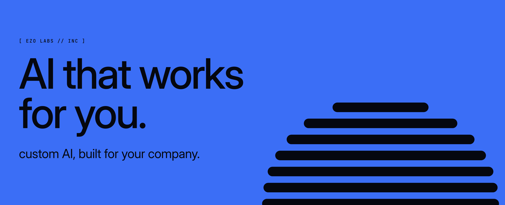

  &nbsp;
  &nbsp;
  &nbsp;
  &nbsp;
  &nbsp;
  

We unlock the gains of AI inside your company: custom AI apps, fine-tuned models, forward deployed engineers and AI security. This is where we publish the code we open up.

| Project | What it does | Links |
| --- | --- | --- |
| [**ezo‑watcher**](https://github.com/ezolabs/ezo-watcher) agent tools | The open-source AI SRE for your project. Monitoring your coding agent installs, proves and fixes. |     |
| [**reqsk‑uaf‑check**](https://github.com/ezolabs/reqsk-uaf-check) security | Tells you whether a Linux host carries the fix for the TCP request-socket use-after-free. One read-only script. |   |
| [**megakernel‑b300**](https://github.com/ezolabs/megakernel-b300) research | DeepSeek-V4.1-Flash's fastest one-user decode past 1,000 tok/s on 4x B300, with NVIDIA's megakernel. The patch, the measured record and the setup kit. |    |

### Get in touch

Work with us: [contact@ezolabs.io](mailto:contact@ezolabs.io). Report a vulnerability privately: [security@ezolabs.io](mailto:security@ezolabs.io).
